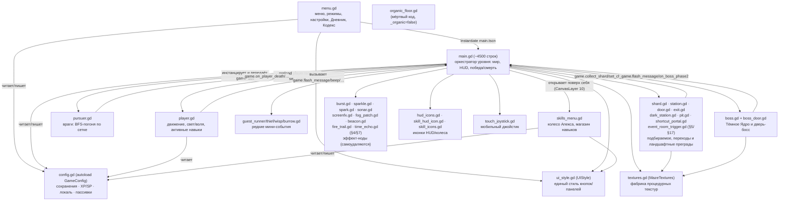
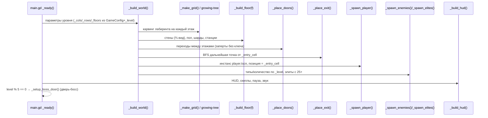
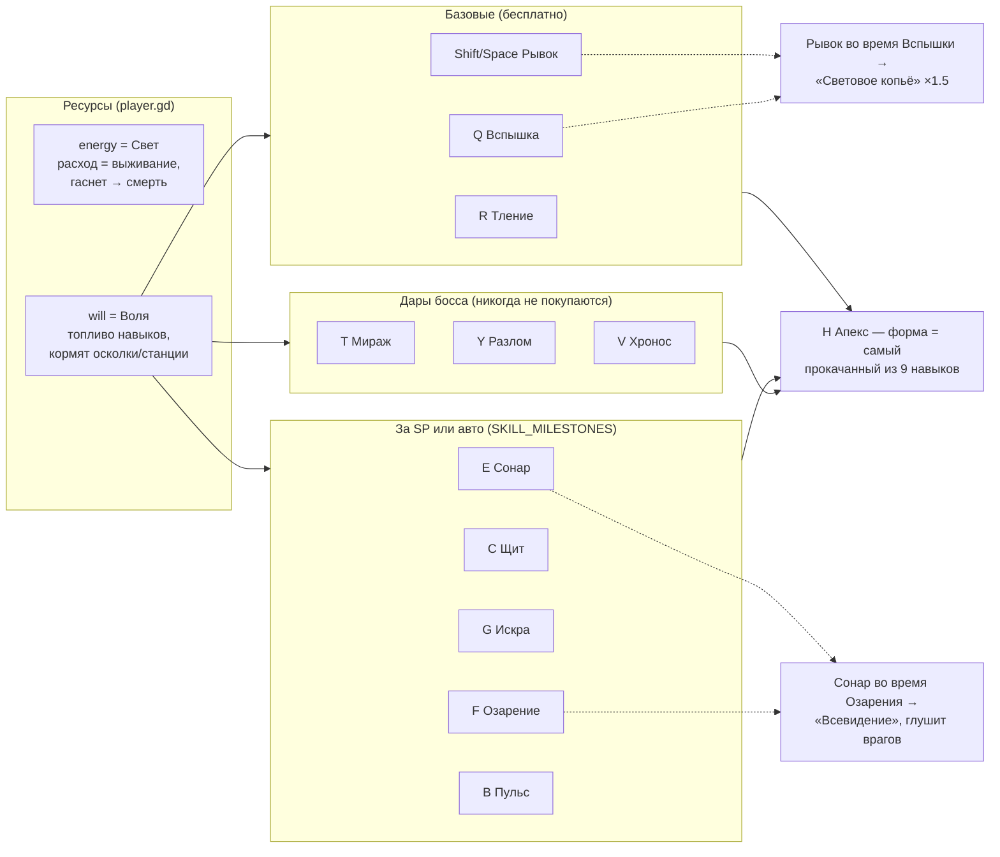
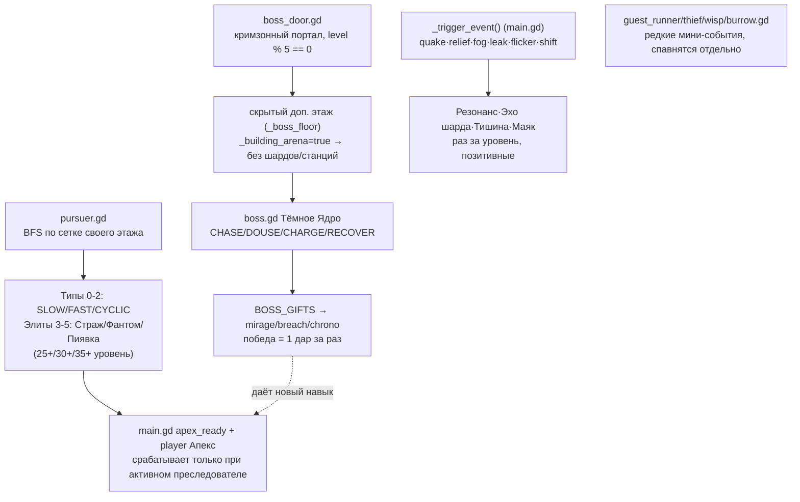
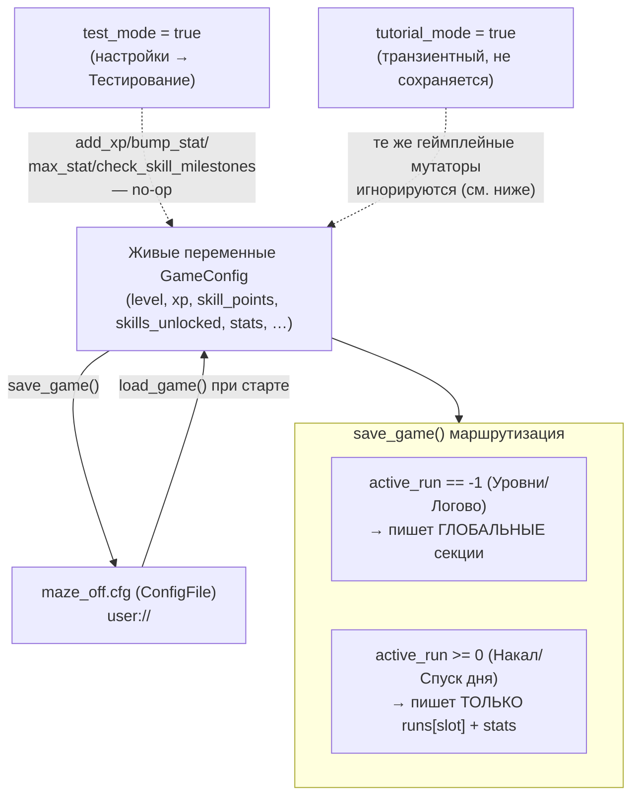
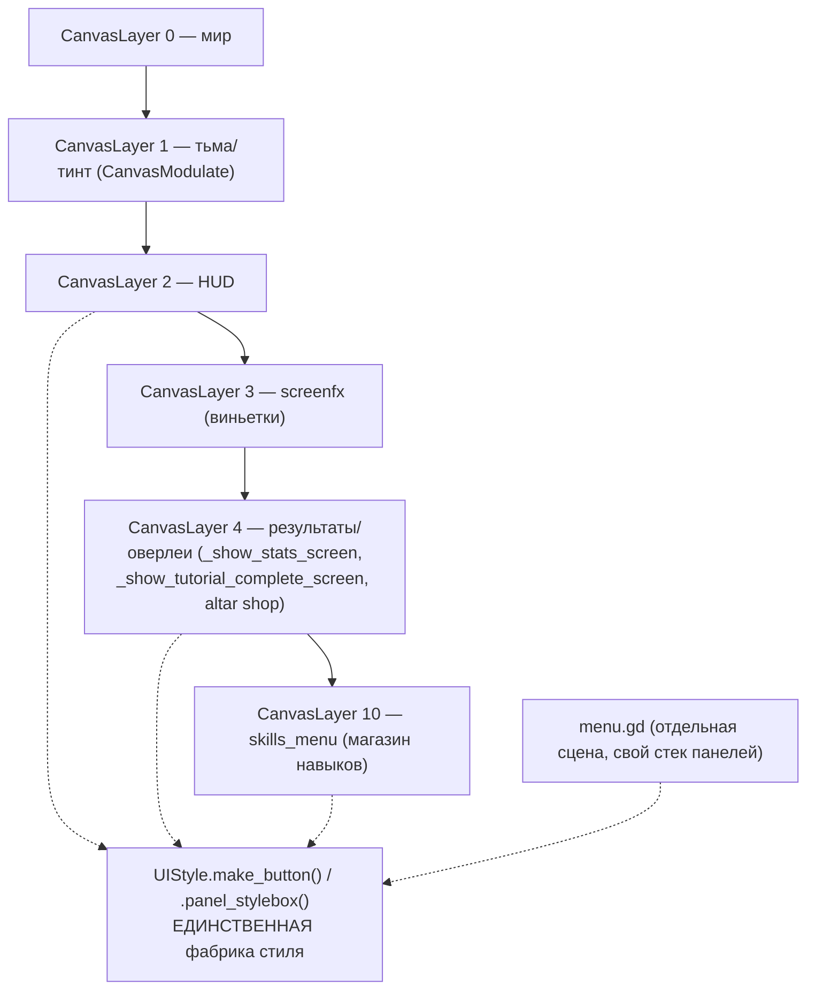
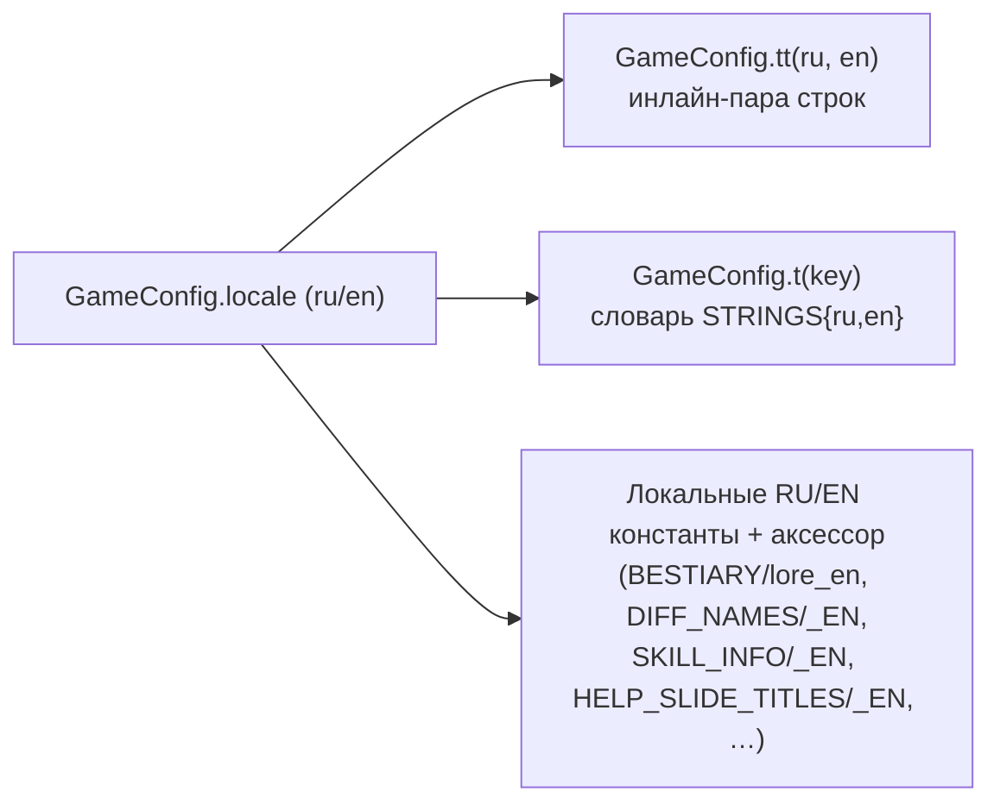

# Архитектура «maze off»

Этот файл — карта того, как всё устроено и как части игры взаимодействуют друг с
другом. Написан для быстрой ориентации: «куда лезть», а не как замена чтению кода.
Подробные соглашения и минные поля — в [CLAUDE.md](CLAUDE.md), это его дополнение
с упором на диаграммы.

**Всё процедурное.** `main.tscn`, `menu.tscn`, `player.tscn` — заглушки в один узел.
Реальный мир, HUD и все экраны строятся кодом в `_ready()`/`_build_*()`. Значит: на
диаграммах ниже узлы сцены — это не `.tscn`-файлы, а то, что код создаёт в рантайме.

---

## 1. Карта модулей — кто на кого ссылается

**Правило связи**: дочерние ноды (враги, подбираемое, эффекты) не хранят
глобальное состояние сами — они дёргают методы `main.gd` через `game`/`_game`
ссылку (`game.flash_message(...)`, `game.collect_shard(...)`, `game.bump_stat`
через `GameConfig` напрямую). `main.gd` — единственный источник истины для
состояния текущего уровня; `GameConfig` — для состояния между уровнями/сессиями.

---

## 2. Экраны и переходы (menu.gd ↔ main.gd)

Ключевой файл-переключатель — **`GameConfig.active_run`**:

| Значение | Режим | Где живёт прогресс |
|---|---|---|
| `-1` | Уровни (классика, 50 уровней) | глобальный профиль (`level`, `max_unlocked_level`, `xp`, `skill_points`) |
| `0..2` | Накал, слоты 1–3 | `GameConfig.runs[slot]` |
| `3` (`DAILY_SLOT`) | Спуск дня | `GameConfig.runs[DAILY_SLOT]` + `daily_history` |
| `-1` + `lair_mode=true` | Логово | `GameConfig.lair_level`, `lair_max_unlocked` |
| `-1` + `tutorial_mode=true` | Обучение | нигде — `add_xp`/`bump_stat`/`add_skill_use` игнорируются (см. §6) |

---

## 3. Жизненный цикл уровня — `main.gd _ready()` → `_build_world()`

Отдельные ветки внутри `_build_world()` (см. CLAUDE.md за деталями):

- **Мега-лабиринт** (уровень ≥ `MEGA_MAZE_FROM_LEVEL`): `_entry_cell` случайная,
  не `(0,0)` — весь код, работающий со стартом/финишем, обязан использовать
  `_entry_cell`, а не жёсткий угол.
- **Дверь-босс**: строит скрытый «этаж-арену» (`_boss_floor = _floors`, уже ПОСЛЕ
  `_place_exit()`, так что exit никогда не попадает на арену).
- **Обучение/Логово**: `_build_world()` подменяет размеры/флаги ДО общей ветки
  карвинга — см. блок `if GameConfig.tutorial_mode / elif GameConfig.lair_mode`.
- **Ленивая постройка этажей**: `_grids` (данные карвинга) считаются для ВСЕХ
  этажей сразу — BFS путей/выхода/дверей работает по ним и построенных нод не
  требует. Но физически (стены+станции+осколки, `_build_floor`) строится сразу
  только этаж входа (`_ensure_floor_built(0)`); остальные этажи мега-лабиринта
  (до 6 этажей × 60×60 клеток) строятся лениво через `_ensure_floor_built(f)` —
  вызывается из `door.gd` перед спуском и из `enter_boss_arena()` для этажа-арены
  двери-босса (`_floor_is_arena[f]`). Причина: постройка/фриинг ~100k нод разом
  на 30+ уровне вешала игру на несколько секунд и при входе на уровень, и при
  выходе в меню. Любой новый код, обращающийся к `_floor_tilemaps[f]` для этажа,
  отличного от `_player.current_floor`, обязан сначала вызвать
  `_ensure_floor_built(f)`.
- **[TILEMAP-1.8] Стены — TileMapLayer, а не нода на клетку.** До версии 1.8
  каждая стена-клетка была отдельной нодой (или несколькими: Node2D + Sprite2D
  крышка + Sprite2D грань + LightOccluder2D + CollisionShape2D) — даже с ленивой
  постройкой этажей это давало тысячи нод на один этаж на мега-уровнях. С 1.8
  весь этаж — **один** `TileMapLayer` (`_floor_tilemaps[f]`): рендер, физика
  (TileSet physics-layer) и тени (TileSet occlusion-layer) — всё на нём разом.
  - Общий `_wall_tileset: TileSet` пересоздаётся в `_build_world()` на уровень
    (цвет темы биома меняется по уровням). Источники (`TileSetAtlasSource`)
    добавляются ЛЕНИВО по ключу `mask*2+with_face` в `_wall_tile_source_id`
    (`_ensure_wall_tile_source`) — тот же принцип кэша, что раньше был у
    `_wall_tex_cache`, только кэшируется id источника, а не текстура.
  - Текстура тайла — `MazeTextures.make_wall_tile_combined()`: крышка
    (`make_wall_tile`) и южная грань (`make_wall_face`) склеены в ОДНО
    изображение высотой `TILE+WALL_H` (грань — прозрачная полоса, если не
    нужна), потому что у TileSet один тайл на клетку, а не две ноды. Крышка
    визуально сдвинута вверх на `WALL_H` через `TileData.texture_origin` —
    тот же эффект, что раньше давал `Sprite2D.position=(0,-WALL_H)`.
  - Боковые грани (восток/запад) — **не переехали на TileMap**, остались тем
    же пулом ≤300 спрайтов (`_update_side_faces`), уже дешёвым. Изменилось
    только откуда пул берёт список кандидатов: `_side_cells[f]` — словарь
    `Vector2i(gx,gy) -> sides:int`, а не список нод (`_register_side_cell`,
    вызывается из `_paint_wall_tile`).
  - Органические уровни (11-20, `_organic`) сейчас мёртвый код (`_organic`
    всегда `false`, см. §1 карту модулей) — но на случай реактивации: их стены
    тоже красятся в `_floor_tilemaps[f]`, только «невидимым» источником
    (прозрачная текстура + та же физика/occlusion) через
    `_ensure_invisible_wall_source()`, потому что визуал там рисует
    `organic_floor.gd` сам через `_draw()`.
  - Квейк-событие/Брешь-скилл (`_set_wall`) и полная перегенерация этажа
    (`regenerate_floor`) теперь просто `tile_map.set_cell()`/`erase_cell()`/
    `clear()` — без ручного учёта нод на удаление.
  - Итог замера на уровне 45 (мега, дверь-босс): нод на входе в уровень
    ~53000 (изначально) → ~26000 (промежуточная правка, один общий
    `StaticBody2D` на этаж) → **~680** (TileMapLayer). Время постройки
    ~2.5-2.9с → ~1.3-2.0с → **~0.8с**; выход в меню — аналогично, до **~0.35с**.
  - История промежуточного варианта (общее физ.тело на этаж без TileMap, тег
    `WALLPERF-2026-07`) — в git-истории коммитов, в текущем коде уже не
    используется.

---

## 4. Игрок: навыки и ресурсы

**Мастерство**: повторная «покупка» уже открытого навыка — не покупка, а
усиление (+1★, максимум 5★, `MASTERY_PER_LEVEL` применений на звезду). Апекс
берёт форму от навыка с наибольшим ★ (`GameConfig.top_mastered`).

**Пассивки** (`GameConfig.PASSIVE_DEFS`) — отдельный слой, всегда включены,
растут САМИ от статистики (`dist_total`, `stations_used`, …), не покупаются и
не выключаются. Читаются в `player._apply_passives()`.

---

### Стойка света (v1.12, GAMEDESIGN §29)

`player.light_stance` (0 Тусклый / 1 Ровный / 2 Яркий) — постоянный режим без
кулдауна и стоимости, переключается `Z`/`X` и колесом мыши через
`set_light_stance()`. Четыре параллельных массива задают эффект и **правятся
только вместе**: `STANCE_RADIUS` (радиус света), `STANCE_DRAIN` (расход
Света), `STANCE_VIS` (заметность), `STANCE_SPEED` (скорость) — плюс
`STANCE_NAMES`/`_EN`/`STANCE_COLORS` для HUD.

Точки подключения: расход — в блоке разрядки `_process` через
`stance_drain_mult()`; радиус — множителем к `base_scale`; заметность — в
`visibility_factor()` (её читает `VIEW_RADIUS` в pursuer.gd); скорость — в
`_physics_process`. **Тление перебивает стойку** — `visibility_factor()`
возвращает `SMOTHER_VIS` раньше, чем смотрит на стойку; не ломай этот порядок,
на нём держится роль Тления как аварийной кнопки.

Смена стойки зовёт хук `on_light_stance_changed()` в main.gd (обновление
HUD-индикатора `_update_stance_hud`, щелчок, флаг обучения). HUD-индикатор
стоит между полосами Света/Воли и строками пассивок — при добавлении новых
элементов в эту полосу HUD проверяй, что ничего не наехало.

---

## 5. Враги, боссы и события

Единая точка учёта убийств — `_note_enemy_death()` (main.gd), вызывается из
ОБОИХ путей смерти врага (`pursuer._die()` и `_destroy_chaser()` апекса).
**Не добавляй новый путь убийства врага в обход этого хука** — на нём висят
статистика/бестиарий/майлстоуны.

### Биом как набор правил (v1.11, GAMEDESIGN §26)

Частота тематических механик **больше не задаётся константами рядом с самим
спавном** — её определяет биом. Каждая запись `BIOMES` (main.gd) несёт ключ
`rules`:

| Поле `rules` | Смысл | Читается через |
|---|---|---|
| `shortcut` / `pits` / `dark_stations` | вероятность спавна (1.0 = гарантия, 0.0 = механики в биоме нет) | `_biome_chance(key)` |
| `guests` / `events` / `rooms` | множители весов внутри пула | `_apply_biome_weights(base, key)` → `_weighted_pick()` |

Правила: **любая новая механика с «шансом за уровень» заводится ключом в
`rules`, а не собственной константой `*_CHANCE`.** Гейты `*_FROM_LEVEL`
остаются — они отвечают за «когда механика вообще вводится», `rules` — за
«в каком биоме она правит». `_biome_rules()` возвращает пустой словарь на
спецуровнях (арена босса, Логово, супербосс, обучение) — у них своя
режиссура. Количество растёт по `_biome_cycle()` (второй проход темы плотнее
первого). Тему объявляет `_announce_biome()` при смене биома; в Накале она
идёт с задержкой, потому что горизонты объявляются на тех же уровнях и тост
в HUD один.

---

## 6. Сохранения и прогресс (`config.gd` / autoload `GameConfig`)

**Обучение не должно прокачивать реальный профиль** — оно намеренно ведёт
себя как `test_mode` для мутаторов `add_xp`/`bump_stat`/`max_stat`/
`check_skill_milestones`, но живое `skill_uses` (мастерство) обучение
ЧИТАЕТ для отслеживания своих шагов («нажми Q» и т.п.) — поэтому вместо
блокировки записи используется снимок/откат
(`main.gd: _tut_skill_uses_snapshot` / `_tut_restore_skill_uses()`),
применяемый в `_goto_menu()` перед `save_game()`.

**Порядок в `end_run` важен**: сначала персист пока `active_run >= 0`,
потом сброс — обратный порядок ломает глобальный профиль (см. CLAUDE.md).

---

## 7. UI-слои и общий стиль

Все Button-ы обязаны идти через `UIStyle` (main.gd, menu.gd, skills_menu.gd) —
исторически несколько экранов рисовали свои кнопки вручную и расходились
стилем (см. CLAUDE.md, «Every Button… must go through UIStyle»).

`menu.gd` — плоский стек панелей-соседей в одной колонке
(`_menu_box`, `_settings_scroll`, `_help_scroll`, `_runs_box`, …),
переключаемых через `_hide_all_panels()` + показ нужной. Обратная навигация —
`_go_back()`, иерархия описана в шапке функции.

---

### Шанс механики: один бросок на уровень (v1.16, GAMEDESIGN §35)

**Если механика одна на уровень — бросок обязан быть один на уровень.**
Вероятность внутри цикла по объектам молча превращается в «почти всегда»:
роль загонщика роллилась на каждого из ~15 врагов, и при шансе 0.5 доставалась
кому-нибудь в 99.997% случаев, а запасной путь (роль Стражу) был недостижим.
Правильный образец — `_assign_herder_role()`: один бросок ПОСЛЕ спавна всех
врагов, затем случайный выбор среди кандидатов.

Ключ `escalation` в `BIOMES[..].rules` — множитель порогов §33 (терпение
лабиринта). Необязателен: отсутствие = 1.0. Читается прямо в
`_escalation_target_stage()`, а не через `_biome_chance()` — это множитель, а
не вероятность.

### Роли врагов (v1.15, GAMEDESIGN §34)

**Роль ≠ тип.** Тип задаёт цифры (`MAX_HP`/`TYPE_MULT`/`VIEW_MULT`/
`LIGHT_COSTS`/`TYPE_COLORS` — правятся только вместе), роль задаёт поведение и
статы НЕ трогает. Добавляя роль, не меняй статы: это ломает весь смысл.

- **Загонщик** — `pursuer.role_herder`. Врезается в выбор цели погони в
  `_update_path()` (`State.CHASE`): вместо клетки игрока берётся
  `_herd_cut_cell()` — сосед игрока, за которым лежит наибольшая область
  (`_flood_size` с запретом прохода через клетку игрока, потолок
  `HERD_FLOOD_CAP`). Вернула `(-1,-1)` — у игрока нет выбора выходов, работаем
  как обычный враг. Роль назначается в `main._spawn_enemies` один раз на
  уровень (`_herder_placed`), частота — `_biome_chance("herders")`.
- **Мимик** — `mimic.gd`, отдельный узел, не враг. Использует ТУ ЖЕ
  `make_charge_station`, что и `station.gd`: подделка обязана быть
  неотличимой, поэтому не заводи ей свою текстуру. При пробуждении зовёт хук
  `main.spawn_mimic_enemy(cell, floor)` и удаляет себя. Спавн —
  `_spawn_mimics()` в те же `station_cells`, частота `_biome_chance("mimics")`.

`_spawn_one_enemy()` теперь ВОЗВРАЩАЕТ созданного врага (`Node2D`) — это нужно
ролям; прежние вызовы игнорируют возврат и работают как раньше.

### Эскалация внутри уровня (v1.14, GAMEDESIGN §33)

`_update_escalation()` (зовётся из `_process` рядом с `_update_guests`) держит
`_escalation_stage` 0→1→2. Стадию считает `_escalation_target_stage()` от
`par = 20 + level*12` через `ESCALATION_STAGE1_MULT`/`STAGE2_MULT` — **не
заводи абсолютных секунд**, иначе порог перестанет масштабироваться с номером
уровня. Стадии только растут; спецуровни (обучение, арены боссов) возвращают 0.

Ловчий: `pursuer.relentless` — проверка стоит ПЕРВОЙ в `_update_state()` и
безусловно держит `CHASE` с актуальной клеткой игрока, минуя видимость и стены.
Балансируется `pursuer.speed_mult` (личный множитель скорости, у обычных врагов
1.0). `main._hunter` держит единственный экземпляр — `_spawn_hunter()`
идемпотентен.

### Награда в моменте (v1.13, GAMEDESIGN §32)

`_show_reward(pos, text, color, size, offset)` в main.gd — единая точка для
всплывающих наград (`float_text.gd`, самоудаляющийся узел). Зови её из ЛЮБОГО
нового места, где игрок что-то получает: молча начисленный ресурс для игрока
не существует. Две надписи из одной точки обязаны разъезжаться через `offset`.
В обучении функция сама себя отключает.

Серия осколков: `_clean_shard_streak` (была скрытым триггером Резонанса с v1.9)
+ `shard_streak_mult()` (`STREAK_STEP`, `STREAK_MULT_MAX`). Растёт в
`collect_shard`, обнуляется в `enemy_hit_fx`, отображается чипом
`_streak_label` внутри `_update_shards()`. **Числа множителя дублируются в
`menu.gd::_codex_streak()`** (константы `_CODEX_STREAK_*`) — menu.gd не грузит
main.gd, поэтому при правке баланса серии правь ОБА места.

### Шум навыков (v1.13, GAMEDESIGN §31)

Второй канал угрозы рядом с заметностью. Цепочка: `player._emit_noise(id)`
(зовётся после КАЖДОГО `GameConfig.add_skill_use`, то есть только на успешном
касте) → `main.make_noise(pos, radius, dur)` → `pursuer.hear(cell, dur)`.

- Громкость — `player.SKILL_NOISE` (мировые px). Новый навык ОБЯЗАН получить
  там запись: отсутствие ключа = бесшумность, и это тихая потеря механики.
- Модификаторы громкости живут в `_emit_noise`: Тление ×0.45, стойка света
  ×0.7/×1.0/×1.35. Ноль в таблице означает «бесшумен по замыслу» (Тление,
  Мираж) — не заполняй его «на всякий случай».
- `hear()` сам фильтрует CHASE/FLEE/RETURN/заморозку и возвращает `bool`:
  `make_noise` по нему красит кольцо (оранжевое — услышали, голубое — нет).
- `make_noise` работает строго по этажу игрока (этажи разнесены по мировому Y,
  без проверки шум дотягивался бы через `_floor_gap`), и использует
  `_world_to_cell()` — обратное к `_cell_to_world()`.
- Визуализация — `noise_ring.gd`, самоудаляющийся эффект. **Не убирай его:**
  без кольца механика невидима и читается как баг AI.

### Кодекс (v1.12, GAMEDESIGN §30)

Экран «Кодекс» (заменил Справку) — двухколоночный: слева навигация
(`_codex_nav`), справа статья (`_codex_article`/`_codex_body`). Данные статей
живут в **codex.gd** (`class_name Codex`: `SECTIONS`, `ARTICLES`, хелперы
`title_of`/`body_of`/`articles_in`) — menu.gd содержит только UI.

Правила при добавлении статьи:
- текст — многострочным литералом `"""..."""` с настоящими переводами строк,
  без `
`-эскейпов (иначе ловится двойное экранирование инструментов);
- абзацы разделяются ПУСТОЙ строкой; список пунктов «•» дополнительно
  режется по одиночному переводу строки;
- обе языковые версии обязательны (`body` и `body_en`);
- картинка задаётся строкой `fig`, а сам билдер — в
  `menu.gd::_codex_figure()`. **Картинки собирать только из генераторов игры**
  (`MazeTextures`, `SkillIcons`) или из `ColorRect`/`PanelContainer` — своя
  копия рисунка обязательно однажды разойдётся с объектом в лабиринте;
- статьи «Что нового» НЕ дублируют чейнджлог: они строятся из тех же
  `CHANGELOG_*`-констант, что и окно «О версиях»;
- после добавления текста — прогон харнесса границ (правило «Screen bounds»).

Кодекс — единственный экран, скрывающий шапку меню (`_set_header_compact`):
логотип отбирал у статьи почти половину высоты.

## 8. Локализация

Три параллельных паттерна локализации в проекте (все три — по дизайну, не
случайность): `tt()` для сообщений/разовых строк, `t(key)` для стабильного UI
меню, отдельные `_EN`-константы + функция-аксессор для больших таблиц данных
(бестиарий, сложности, майлстоуны, слайды справки, changelog). Если пишешь
новый текст — используй `tt()`, если не заводишь под него отдельную таблицу.

---

## 9. Куда лезть за конкретной задачей

| Задача | Файл(ы) |
|---|---|
| Новый активный навык игрока | `player.gd` (`_try_*`), `main.gd` (`_update_skills_hud`, HUD-иконка), `skills_menu.gd` (`SKILL_INFO`) |
| Новый враг/элита | `pursuer.gd`, `main.gd` (`_spawn_elites`, массивы `MAX_HP/TYPE_MULT/…`), `config.gd` (`BESTIARY`) |
| Новое случайное событие | `main.gd` (`_trigger_event`, `_update_events`) |
| Новый «гость лабиринта» | `guest_*.gd` + спавн в `main.gd` (`_spawn_guest`) |
| Новый экран меню | `menu.gd` (`_build_*` + `_on_open_*` + `_hide_all_panels()`) |
| Новая пассивка | `config.gd` (`PASSIVE_DEFS`/`PASSIVE_DEFS_EN`), читает `player._apply_passives()` |
| Новый текст/сообщение | обернуть в `GameConfig.tt(ru, en)` — см. §8 |
| Новая механика Накала | `config.gd` (`RUN_CONTRACTS`, обеты), `main.gd` (`_ember_mult`, `_persist_ember`) |

---

*Этот файл описывает структуру на момент версии 1.7. При крупных
архитектурных изменениях (новый режим, смена автозагрузки, новый слой UI) —
обнови соответствующую диаграмму.*
