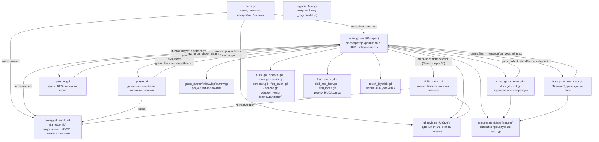
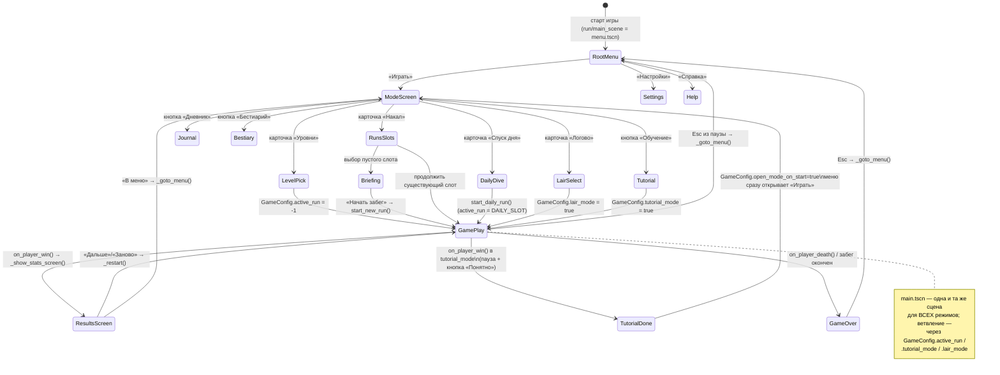
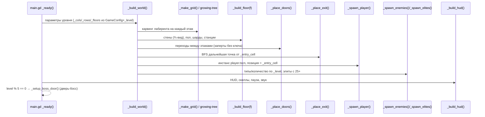
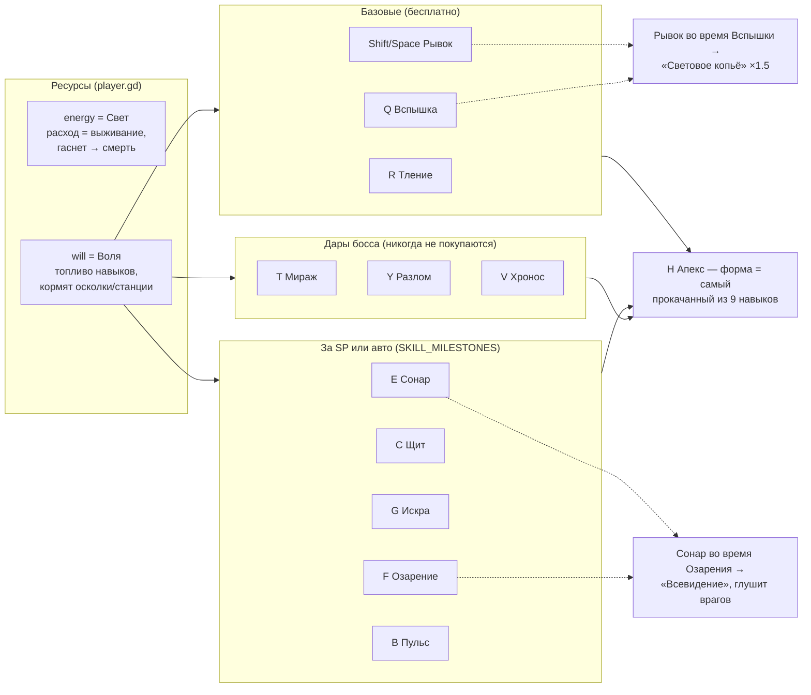
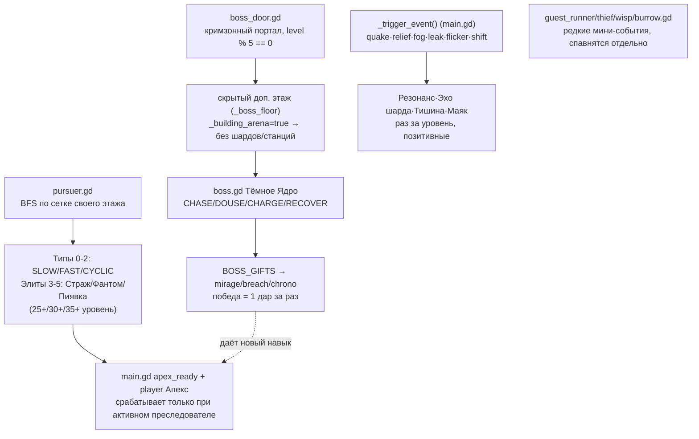
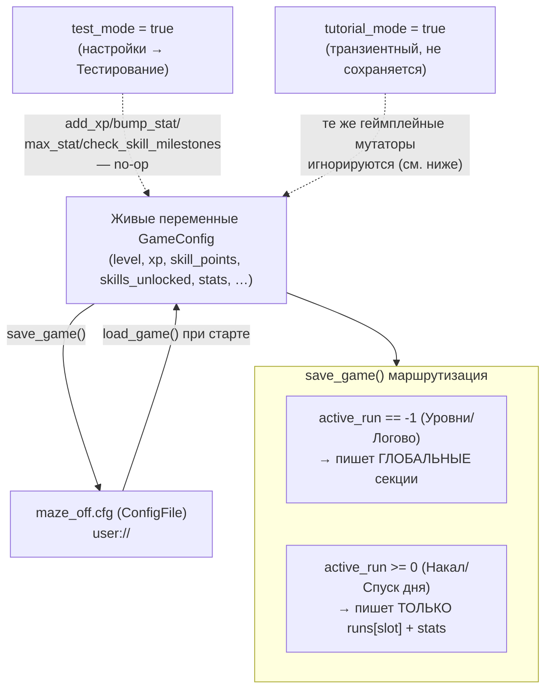
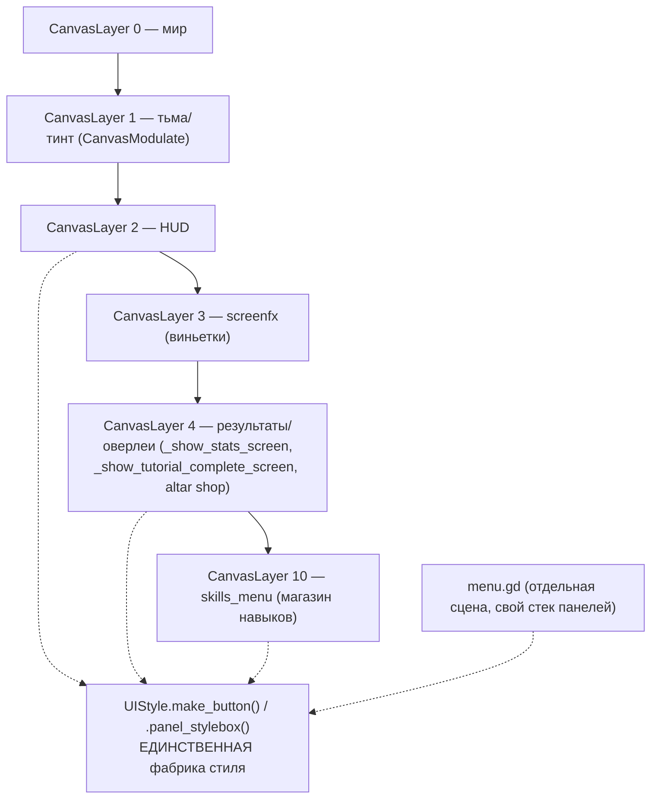
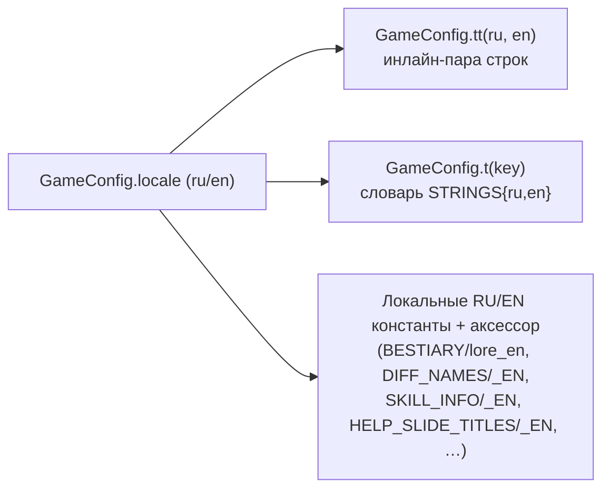

# Архитектура «maze off»

Этот файл — карта того, как всё устроено и как части игры взаимодействуют друг с
другом. Написан для быстрой ориентации: «куда лезть», а не как замена чтению кода.
Подробные соглашения и минные поля — в [CLAUDE.md](CLAUDE.md), это его дополнение
с упором на диаграммы.

**Всё процедурное.** `main.tscn`, `menu.tscn`, `player.tscn` — заглушки в один узел.
Реальный мир, HUD и все экраны строятся кодом в `_ready()`/`_build_*()`. Значит: на
диаграммах ниже узлы сцены — это не `.tscn`-файлы, а то, что код создаёт в рантайме.

---

## 1. Карта модулей — кто на кого ссылается

**Правило связи**: дочерние ноды (враги, подбираемое, эффекты) не хранят
глобальное состояние сами — они дёргают методы `main.gd` через `game`/`_game`
ссылку (`game.flash_message(...)`, `game.collect_shard(...)`, `game.bump_stat`
через `GameConfig` напрямую). `main.gd` — единственный источник истины для
состояния текущего уровня; `GameConfig` — для состояния между уровнями/сессиями.

---

## 2. Экраны и переходы (menu.gd ↔ main.gd)

Ключевой файл-переключатель — **`GameConfig.active_run`**:

| Значение | Режим | Где живёт прогресс |
|---|---|---|
| `-1` | Уровни (классика, 50 уровней) | глобальный профиль (`level`, `max_unlocked_level`, `xp`, `skill_points`) |
| `0..2` | Накал, слоты 1–3 | `GameConfig.runs[slot]` |
| `3` (`DAILY_SLOT`) | Спуск дня | `GameConfig.runs[DAILY_SLOT]` + `daily_history` |
| `-1` + `lair_mode=true` | Логово | `GameConfig.lair_level`, `lair_max_unlocked` |
| `-1` + `tutorial_mode=true` | Обучение | нигде — `add_xp`/`bump_stat`/`add_skill_use` игнорируются (см. §6) |

---

## 3. Жизненный цикл уровня — `main.gd _ready()` → `_build_world()`

Отдельные ветки внутри `_build_world()` (см. CLAUDE.md за деталями):

- **Мега-лабиринт** (уровень ≥ `MEGA_MAZE_FROM_LEVEL`): `_entry_cell` случайная,
  не `(0,0)` — весь код, работающий со стартом/финишем, обязан использовать
  `_entry_cell`, а не жёсткий угол.
- **Дверь-босс**: строит скрытый «этаж-арену» (`_boss_floor = _floors`, уже ПОСЛЕ
  `_place_exit()`, так что exit никогда не попадает на арену).
- **Обучение/Логово**: `_build_world()` подменяет размеры/флаги ДО общей ветки
  карвинга — см. блок `if GameConfig.tutorial_mode / elif GameConfig.lair_mode`.

---

## 4. Игрок: навыки и ресурсы

**Мастерство**: повторная «покупка» уже открытого навыка — не покупка, а
усиление (+1★, максимум 5★, `MASTERY_PER_LEVEL` применений на звезду). Апекс
берёт форму от навыка с наибольшим ★ (`GameConfig.top_mastered`).

**Пассивки** (`GameConfig.PASSIVE_DEFS`) — отдельный слой, всегда включены,
растут САМИ от статистики (`dist_total`, `stations_used`, …), не покупаются и
не выключаются. Читаются в `player._apply_passives()`.

---

## 5. Враги, боссы и события

Единая точка учёта убийств — `_note_enemy_death()` (main.gd), вызывается из
ОБОИХ путей смерти врага (`pursuer._die()` и `_destroy_chaser()` апекса).
**Не добавляй новый путь убийства врага в обход этого хука** — на нём висят
статистика/бестиарий/майлстоуны.

---

## 6. Сохранения и прогресс (`config.gd` / autoload `GameConfig`)

**Обучение не должно прокачивать реальный профиль** — оно намеренно ведёт
себя как `test_mode` для мутаторов `add_xp`/`bump_stat`/`max_stat`/
`check_skill_milestones`, но живое `skill_uses` (мастерство) обучение
ЧИТАЕТ для отслеживания своих шагов («нажми Q» и т.п.) — поэтому вместо
блокировки записи используется снимок/откат
(`main.gd: _tut_skill_uses_snapshot` / `_tut_restore_skill_uses()`),
применяемый в `_goto_menu()` перед `save_game()`.

**Порядок в `end_run` важен**: сначала персист пока `active_run >= 0`,
потом сброс — обратный порядок ломает глобальный профиль (см. CLAUDE.md).

---

## 7. UI-слои и общий стиль

Все Button-ы обязаны идти через `UIStyle` (main.gd, menu.gd, skills_menu.gd) —
исторически несколько экранов рисовали свои кнопки вручную и расходились
стилем (см. CLAUDE.md, «Every Button… must go through UIStyle»).

`menu.gd` — плоский стек панелей-соседей в одной колонке
(`_menu_box`, `_settings_scroll`, `_help_scroll`, `_runs_box`, …),
переключаемых через `_hide_all_panels()` + показ нужной. Обратная навигация —
`_go_back()`, иерархия описана в шапке функции.

---

## 8. Локализация

Три параллельных паттерна локализации в проекте (все три — по дизайну, не
случайность): `tt()` для сообщений/разовых строк, `t(key)` для стабильного UI
меню, отдельные `_EN`-константы + функция-аксессор для больших таблиц данных
(бестиарий, сложности, майлстоуны, слайды справки, changelog). Если пишешь
новый текст — используй `tt()`, если не заводишь под него отдельную таблицу.

---

## 9. Куда лезть за конкретной задачей

| Задача | Файл(ы) |
|---|---|
| Новый активный навык игрока | `player.gd` (`_try_*`), `main.gd` (`_update_skills_hud`, HUD-иконка), `skills_menu.gd` (`SKILL_INFO`) |
| Новый враг/элита | `pursuer.gd`, `main.gd` (`_spawn_elites`, массивы `MAX_HP/TYPE_MULT/…`), `config.gd` (`BESTIARY`) |
| Новое случайное событие | `main.gd` (`_trigger_event`, `_update_events`) |
| Новый «гость лабиринта» | `guest_*.gd` + спавн в `main.gd` (`_spawn_guest`) |
| Новый экран меню | `menu.gd` (`_build_*` + `_on_open_*` + `_hide_all_panels()`) |
| Новая пассивка | `config.gd` (`PASSIVE_DEFS`/`PASSIVE_DEFS_EN`), читает `player._apply_passives()` |
| Новый текст/сообщение | обернуть в `GameConfig.tt(ru, en)` — см. §8 |
| Новая механика Накала | `config.gd` (`RUN_CONTRACTS`, обеты), `main.gd` (`_ember_mult`, `_persist_ember`) |

---

*Этот файл описывает структуру на момент версии 1.7. При крупных
архитектурных изменениях (новый режим, смена автозагрузки, новый слой UI) —
обнови соответствующую диаграмму.*
